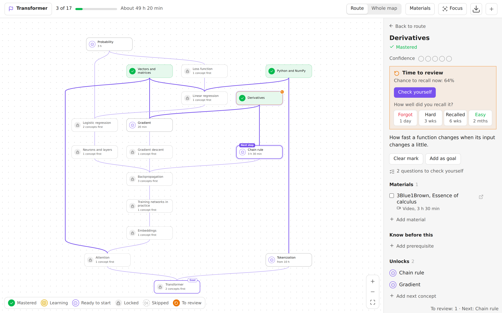
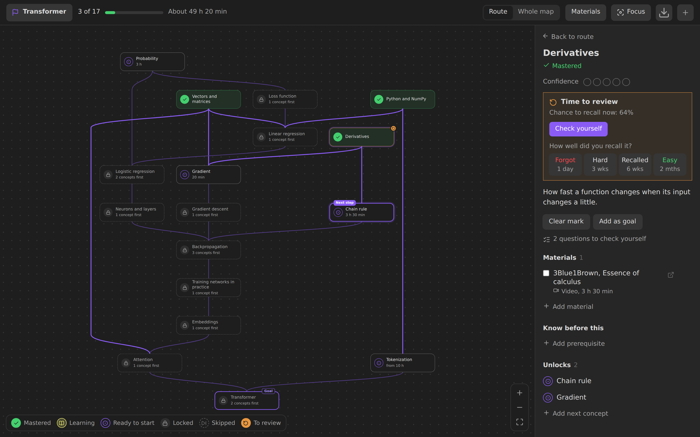
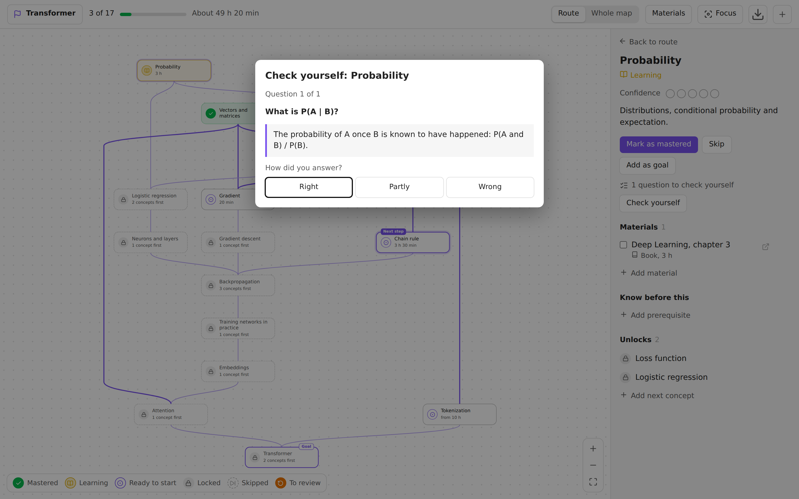
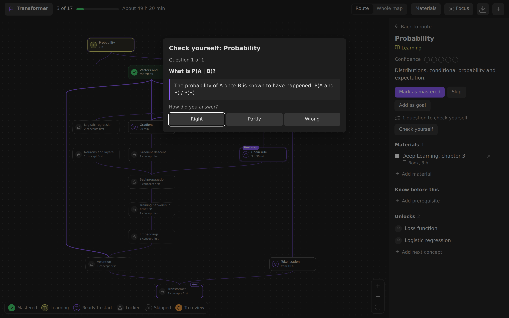
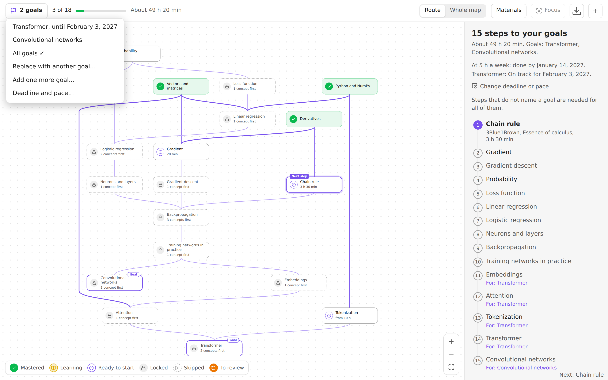
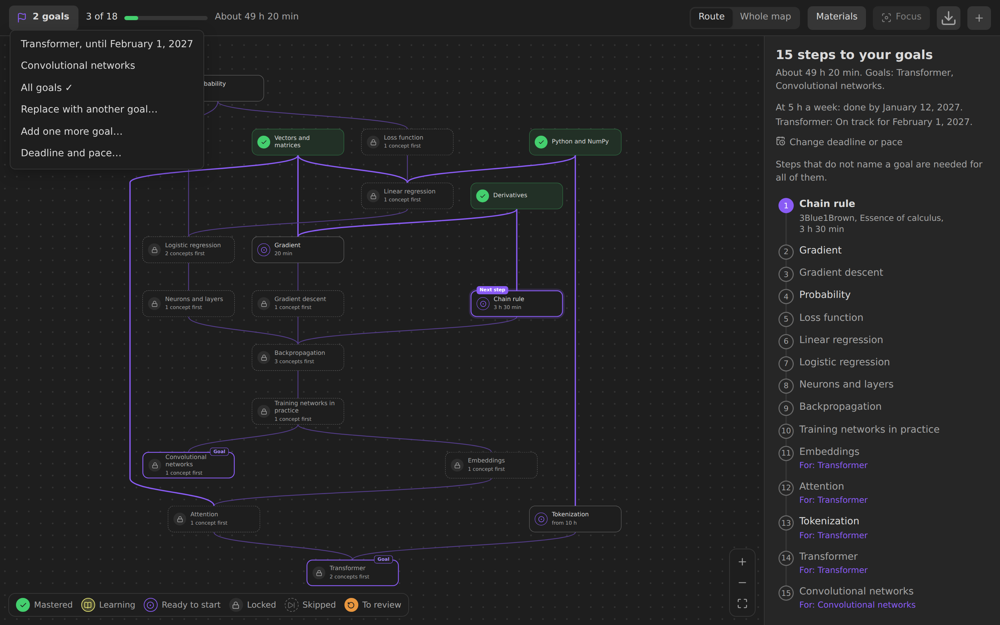
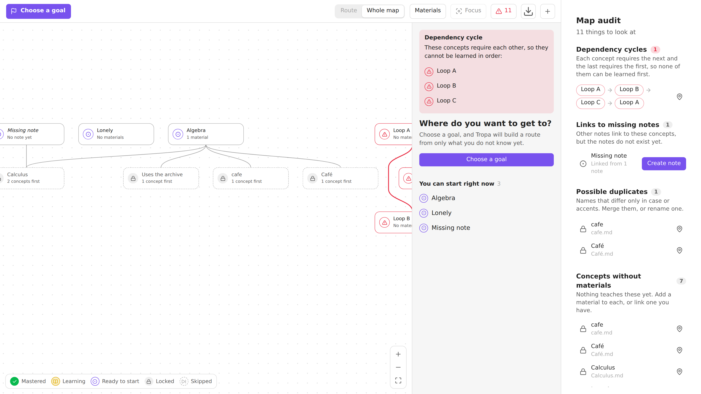

# Tropa

[Русская версия](README.ru.md)

Tropa turns ordinary notes into a graph of concepts and learning materials, and builds a personal route to any goal from what you do not know yet.


## What's new in 0.4

- **Several goals, a deadline and a pace:** route to one goal or all of them, and see when you finish at your pace.
- **Learning journal:** every change of progress is appended to a file per month and device, and the side panel sums up your activity.
- **Review with FSRS:** mastered concepts come back when you are about to forget them, in **Review today**, without blocking the route.
- **Self-check:** questions as callouts in a concept's note, asked one at a time before you mark it mastered and when you review it.
- **A smaller `main.js`:** translations no longer repeat their keys.

Requires Obsidian 1.13.0. The full list is in the [changelog](CHANGELOG.md).

## Features

- **Route to a goal.** Pick a concept you want to learn. Tropa shows only the steps that lead to it, in order, with the next one highlighted.
- **Concepts and materials.** A concept is something you want to understand. A material is an article, video, book, paper, course or your own note that teaches it. A material can be a note of its own, or just a link or an attachment listed in the concept.
- **Progress you can see.** Mark concepts as learning or mastered and materials as done. Mastering a concept unlocks the ones that depend on it. Every action can be undone.
- **Start from what you know.** **I know this and what it needs** marks a concept together with its unmastered prerequisites in one step; untick anything you are unsure of. **Skip** leaves a concept out: it opens what depends on it but never counts as mastered. An optional confidence from 1 to 5 can be set on mastered and learning concepts.
- **Time estimate.** Material durations add up to the time left on the route.
- **Several goals, a deadline and a pace.** Keep more than one goal and switch between them with the goal button, or route to all of them at once: a step only some goals need names them. Set how many hours a week you study and a deadline for each goal under **Deadline and pace…**, and the route says when you finish at that pace, what each deadline asks for, and how many steps have no time estimate yet.
- **Focus and fold.** **Focus** (or F) shows only what is near the selected concept: what it needs, what it opens and soft links, one to three steps around, with their materials when **Materials** is on. Esc or the cross brings back the map as it was. The badge under a concept folds away everything that needs it and then shows how many concepts it hides; a highlighted badge means route steps are among them, and the route list marks them. Picking such a step unfolds its branch. Focus and folds belong to the map view: they are kept with Obsidian's workspace layout, never in notes or progress.
- **Export.** The download button in the bar, or the commands **Export map to Canvas** and **Export map as SVG**, save the map as it is drawn now: route or whole map, with materials, focus and folds. The canvas keeps the positions and points at your notes, so it opens in Obsidian Canvas; coloring it by your progress is optional, so a map can be shared without it. JSON Canvas has no dashed lines, so soft links are orange with a label and material links cyan. The SVG takes the colors and fonts of the current theme. An existing file is never replaced without asking.
- **Edit on the map.** Drag from the dot under a concept to another concept to link them, or to empty space to create the next one. Links that would create a cycle are refused.
- **Suggested links.** Your notes already link to each other. **Suggest links from your notes** reads a folder, the whole vault or one note and offers those links for the map, in a preview: nothing is written until you add it, and a batch can be undone. See [Suggested links](#suggested-links).
- **Map from a list.** Paste a list, headings or the table of contents of a book: each line becomes a concept and nesting becomes links, in a preview that also shows which notes are new and which are already in your vault. See [Map from a list](#map-from-a-list).
- **In your notes and the status bar.** A `tropa` code block shows the route, today's reviews or the next step in any note, such as a daily note, with boxes to tick. The status bar says how many concepts are due today and what comes next. Hover a node on the map, with Ctrl or Cmd, to preview its note. See [The tropa block and the status bar](#the-tropa-block-and-the-status-bar).
- **Plain files.** The graph lives in note properties, so it syncs and travels like any other notes. Your goal and marks live in a separate file, so you can share a map without your progress.
- **Sidebar panel.** Shows where the open note sits in the graph, and adds any note to the map in one click.
- **Learning journal.** Every change of your progress is appended as a line to a journal file, one per month and device, so devices never edit the same file. The side panel sums it up: concepts mastered, time with finished materials and reviews over the last 7 and 30 days, from all your devices. See [Learning journal](#learning-journal).
- **Review.** Mastered concepts come back when you are about to forget them, scheduled by [FSRS](https://github.com/open-spaced-repetition/ts-fsrs) from the journal. A concept that is due keeps its mark and blocks nothing; it gets a badge on the map and a place in **Review today** above the route. Rate how well you recalled it (**Forgot**, **Hard**, **Recalled**, **Easy**), and each button says when it would come back. See [Review](#review).
- **Self-check.** Write questions in a concept's note as callouts, `> [!question]- Question` with the answer inside. **Check yourself** asks them one at a time, shows the answer on a press and lets you grade your own answer; the grades suggest how well you know the concept. Marking a concept with questions mastered offers the check first, and a check is a review once the concept is mastered. See [Self-check](#self-check).
- **Map audit.** The command **Tropa: Audit the map** opens one list of what needs a look:
  - dependency cycles, shown as a chain back to where they start;
  - links to missing notes, with how many notes point to each and a button to create it;
  - possible duplicates, names that differ only in case or accents;
  - concepts without materials;
  - notes with no links at all;
  - concepts without self-check questions, when turned on in the settings.

  Each row opens its note or shows it on the map, and the list updates as you fix things. When there is something to look at, a button in the map's bar shows how many, in red if there is a cycle, and opens the audit.
- **Keyboard.** Arrow keys move between concepts, Enter opens details, Shift+Enter opens the note, M toggles mastered, F focuses on the concept or leaves the focus, 1–3 set the steps around, C folds or unfolds what the concept opens, Esc leaves the focus and then returns to the route.
- **33 languages.** The interface follows Obsidian's language, right-to-left included. See [Languages](#languages).

## Screenshots

| | Light | Dark |
|---|---|---|
| Route |  |  |
| Concept details |  |  |
| Whole map with materials |  |  |
| Review: a concept due, with the four ratings |  |  |
| Self-check with the answer shown |  |  |
| Two goals, the route to both, deadline and pace |  |  |

The map audit, opened from its button in the map's bar: a cycle, a link to a missing note, a duplicate name, concepts without materials and a lone note.



## Installation

Tropa requires Obsidian 1.13.0 or later.

### From Community plugins

Once Tropa is listed: open **Settings → Community plugins → Browse**, search for **Tropa**, install it and enable it.

### Manually

1. Download `main.js`, `manifest.json` and `styles.css` from the [latest release](https://github.com/Darkildo/tropa/releases/latest).
2. Put them in `<your vault>/.obsidian/plugins/tropa/`.
3. Reload Obsidian and enable **Tropa** in **Settings → Community plugins**.

### With BRAT

Install [BRAT](https://github.com/TfTHacker/obsidian42-brat), run **BRAT: Add a beta plugin for testing** and enter `Darkildo/tropa`.

## Usage

1. Open the map with the route icon in the left ribbon or the command **Tropa: Learning map**.
2. In an empty vault, choose **Show example** to add an example map, or **Create first concept**. If your notes already link to each other, **Suggest links from my notes** starts the map from them; with a course outline or a book at hand, **Map from a list** does.
3. Choose a goal in the top left corner. The panel on the right lists the steps and what to study first. The same button later adds more goals, switches between them, shows the route to all of them and opens **Deadline and pace…**.
4. Click a concept, press **Start learning**, then **Mark as mastered** when you are done.
5. Switch between **Route** and **Whole map**, and turn on **Materials** to see them on the map.
6. On a big map, select a concept and press **Focus** to see only what is near it, or fold the branches you do not need with the badge under a concept.
7. Come back for **Review today** above the route: open a due concept and rate how well you recalled it, or **Check yourself** if its note has questions.

### On a phone

- The bar is one row: the goal, **Route** and **Whole map** as icons, and **⋯** with materials, focus, the audit (its count shows on the button), export and a new concept. The progress is the thin line under it.
- Drag with one finger to move around the map, pinch to zoom, double tap to zoom in. Swipes inside the map and the panel move the map or the panel, not Obsidian's side panels; swipe on the bar or use Obsidian's buttons for those.
- Tap a concept to open its details. Hold a concept for its menu, which also links it to the next concept (there is no dot to drag on a phone).
- The panel sits above Obsidian's navigation bar. Tap or drag its handle between the title, half the screen and nearly all of it.
- The map opens and fits at a size you can read, centred on the selection, the next step or the goal.

Other commands: suggest links from your notes and undo the last suggested links, create a map from a list and undo it, check yourself on the open concept, review the next concept, open the review queue, audit the map, open the sidebar panel, create a concept, find a concept on the map, export the map to Canvas or SVG, make the open note a concept or a material, add it to your goals or remove it from them, set the deadline and pace, mark it mastered, skip it, and mark it known with everything it needs.

## Data model

```yaml
# Concept
---
type: concept
requires: ["[[Derivatives]]"]     # must be mastered first
recommends: ["[[Probability]]"]   # useful, does not block access
summary: Short description
materials:                        # optional: materials without a note of their own
  - https://en.wikipedia.org/wiki/Gradient
  - "[[Deep Learning.pdf]]"
  - "[The Illustrated Transformer](https://jalammar.github.io/illustrated-transformer/)"
  - { url: https://youtu.be/IHZwWFHWa-w, title: "Gradient descent, 3Blue1Brown", format: video, minutes: 21 }
---

# Material
---
type: source
format: video                     # video, article, book, paper, course, note, other
minutes: 45
url: https://example.com
teaches: ["[[Gradient descent]]"]
requires: ["[[Derivatives]]"]     # a concept or another material
---
```

Your goal and marks are stored in `Tropa/Progress.md`:

```yaml
---
type: learning-progress
goal: "[[Transformer]]"                          # the goal the route leads to
goals: ["[[Transformer]]", "[[Fine-tuning]]"]   # optional, every goal once there is more than one
all-goals: true                                  # optional, route to all goals at once
deadline-2026-12-31: ["[[Transformer]]"]         # optional, goals due that day
pace-hours: 5                                    # optional, hours of study a week
mastered: ["[[Derivatives]]", "[[Vectors and matrices]]"]
learning: ["[[Gradient]]"]
done: ["[[3Blue1Brown, Essence of calculus]]"]   # finished materials
skipped: ["[[Probability]]"]                      # opens what depends on it, not counted as mastered
confidence-4: ["[[Derivatives]]"]                 # optional, confidence-1 … confidence-5
done-materials:                                   # finished materials listed inside concepts
  - https://en.wikipedia.org/wiki/Gradient
  - "[[Deep Learning.pdf]]"
---
```

A material in a concept's `materials` list is a URL, a link to an attachment or a note, a Markdown link `[title](url)`, or an object with `url` or `file` and optional `title`, `format` and `minutes`. Without a title a link is named by its address and an attachment by its file name; without a format it is guessed from the address or the file extension. The same link in several concepts is one material that teaches all of them. A link that is already a material note, by the note itself or by its `url`, is shown as that note. Such materials count in the route time like any other, and the map shows them with the other materials. Finished ones go to `done-materials`: URLs as they are, attachments as links, so renaming the file keeps the mark.

`goal` always holds the goal the route leads to, so an older version of Tropa reads such a file as it did and routes to that goal; a goal it sets there is added to `goals`. Deadlines are grouped by date as plain links, so renaming a note keeps them and the Properties editor shows them as an ordinary list. The forecast counts the durations of the materials on the route, from today, with the deadline day as a day of study.

`goals`, `all-goals`, the `deadline-…` lists, `pace-hours`, `skipped`, `done-materials` and the `confidence-N` lists are written only when they hold something and removed when they become empty, so a file from an earlier version reads as it is and stays unchanged until you use them. Marks are links, so renaming a note keeps them. A link to a note that does not exist yet becomes a placeholder concept, and you can create the note with one button. Property names, folders and the progress file can be changed in the settings. Default paths follow Obsidian's language on first launch and are saved, so they do not move later.

### Map scope

**Settings → Tropa → Map scope** leaves notes out of the map, one entry per line:

- **Excluded folders**: a folder and everything below it. Folders match whole path segments, so `Archive` does not cover `Archive 2`. Keep the concepts and materials folders out of this list: what you create from the map goes there, and Tropa warns when you exclude them.
- **Excluded tags**: tags from the `tags` property and from the note text, `#` optional, case ignored. A tag covers its nested tags: `#draft` also excludes `#draft/old`.

Excluded notes leave the map completely: a `requires`, `recommends` or `teaches` link to one is dropped, so it adds no node, no route step and blocks nothing, and what needed only that note becomes available. The side panel still says when the open note is left out. Marks on excluded notes stay in the progress file as they are and return with the note, and the progress file is read even when its folder is excluded. Attachments listed in a concept's `materials` stay on the map wherever they are stored: the scope picks notes, not the files a note on the map points at. If the goal itself is excluded, Tropa says so and asks to choose another goal or change the settings.

### Learning journal

`Tropa/Progress.md` says where you stand; the journal says how you got there. Each change made on this device is appended to `Tropa/Journal/<YYYY-MM> <device>.md`:

```markdown
- 2026-11-03T14:05:12+03:00 started [[Gradient]]
- 2026-11-03T14:31:40+03:00 mastered [[Gradient]]
- 2026-11-03T14:31:44+03:00 unmastered [[Gradient]] undo
- 2026-11-03T14:40:02+03:00 confidence [[Derivatives]] level=4
- 2026-11-03T15:10:00+03:00 done https://en.wikipedia.org/wiki/Gradient
```

- A line is the local time with its offset, an action, the note as a link (a URL or `[[attachment]]` for a material listed in a concept, `-` for none) and optional `key=value` fields and flags. Actions: `goal` (the goal the route now leads to), `goal-added` and `goal-removed` (other goals kept or dropped), `deadline` (`date=` or `date=none`), `pace` (`hours=` or `hours=none`), `started`, `stopped`, `mastered`, `known` (marked with **I know this**), `unmastered`, `skipped`, `unskipped`, `done`, `undone`, `confidence`, `reviewed` and `checked` (a review and a self-check, with `rating=1`…`4` and an optional `shift=`, see [Review](#review)), `pause` (`until=`, the day review comes back) and `resume`.
- Undo appends lines flagged `undo` that put things back, instead of erasing lines: the files only grow, so a sync never has to merge two versions of one.
- The device name, like `desktop-3f9a` or `phone-07c1`, is kept by Obsidian on the device and is not synced. Each device writes only its own file and reads all of them, so the activity in the panel covers every device.
- Links follow renames like any other links. Lines that do not parse, such as notes you add between them, are skipped.
- Only changes made in Tropa are written. A progress file edited by hand or changed by a sync from another device is not, since that device writes its own lines.
- **Settings → Tropa → Learning journal** turns it off or moves the folder. The folder is never on the map. Vaults without a journal work as before; the panel shows activity once there is something to show.

### Review

Review is scheduled by FSRS ([ts-fsrs](https://github.com/open-spaced-repetition/ts-fsrs), MIT) and nothing about it is stored but the journal. The state of each concept is replayed from its lines, so a review on another device, an Undo or a new target recall are taken into account the same way:

```markdown
- 2026-11-03T14:31:40+03:00 mastered [[Gradient]]
- 2026-11-06T09:12:03+03:00 reviewed [[Gradient]] rating=3
```

- The memory of a concept starts when it is marked mastered (as a **Recalled** answer) or known with **I know this** (as **Easy**), and every review after that is one more FSRS step. A self-check just before the mark sets how well it starts.
- A concept is due when the chance to recall it falls below the target recall, 90% by default (**Settings → Tropa → Review**). It stays mastered and opens what it opened: review never blocks the route. The map marks it with a badge, and **Review today** in the panel lists the due concepts, the easiest to forget first. On a phone they are in the panel at the bottom of the map.
- Ratings: **Forgot**, **Hard**, **Recalled**, **Easy**, as FSRS's 1 to 4. A concept that is not due can be reviewed early with **Review now**. Undo after a rating appends a `reviewed … undo` line.
- Marks made before the journal, or on a device without one, have no date. They start on the day review is first on and come due a few a day over one week to two months, so an old map does not come due all at once. The day and the spread are saved in the settings.
- Commands: **Review the next concept**, **Open the review queue**, **Pause review** and **Resume review**.
- Review needs the journal: it is where reviews are kept and how they reach your other devices. With the journal off, review is off too.

#### How many reviews a day

None of these change what FSRS knows about a concept, only the day it is shown.

- **Reviews a day** (**Settings → Tropa → Review**, 20 by default, or no limit): today's queue takes the concepts easiest to forget first, and at the same chance to recall, those your goals lead through. The rest wait for the next days, and the head of **Review today** says how many of all are shown, such as `20 of 37`. Reviews already done today count, so the queue does not fill up again as you work through it. A concept over the limit has no badge on the map; its details say it is due and keep the ratings behind **Review now**.
- **Spread reviews evenly** (on by default): when you rate a concept, its next review may move by up to 5% of the interval, three days at most, to the day with the fewest reviews nearby. The move is written into the review line, so every device shows the same day:

  ```markdown
  - 2026-11-20T09:12:03+03:00 reviewed [[Gradient]] rating=3 shift=-1
  ```

  A shift that no longer fits the interval, after a change of the target recall, is ignored. Intervals under 20 days never move.
- **Pause review**, from the pause button in the head of **Review today** or the command, asks for the day review comes back (a week by default) and writes it to the journal, so all your devices pause:

  ```markdown
  - 2026-11-04T09:00:00+03:00 pause - until=2026-11-20
  - 2026-11-15T18:40:12+03:00 resume -
  ```

  While paused, the queue is empty and the map shows no review badges. When the pause ends, on its day or with **Resume**, what came due meanwhile is spread over as many days as the pause lasted, two weeks at most, a few concepts a day, instead of all at once. Versions before 0.5 skip these lines.

### Self-check

Questions are callouts in the body of a concept's note. The title is the question, the inside is the answer, folded or not:

```markdown
> [!question]- Where does the gradient point?
> Towards the fastest growth of the function.
```

- **Check yourself**, in a concept's details, on a row of **Review today** or with the command, asks the questions one at a time. Space or **Show answer** opens the answer, and you grade your own answer: **Right**, **Partly** or **Wrong** (keys 1 to 3).
- The grades suggest a rating: all right is **Recalled**, and **Easy** with at least three questions; three quarters right is **Recalled** too, about half **Hard**, less **Forgot**. A partly right answer counts as half.
- On a concept that is not mastered yet, the check ends with **Mark as mastered** or **Not yet**. Either way the result goes to the journal as `checked … rating=N`, and a mastered mark within a day starts its memory at that rating. Marking a concept with questions mastered offers the check first; skip it, or turn the offer off in the settings.
- On a mastered concept the check is a review: pick one of the four ratings, the suggested one first in line.
- Closing the window saves nothing. Undo in the notice after a check appends a `reviewed … undo` line.
- Tropa only reads the note, never changes it. **Settings → Tropa → Self-check** sets the callout type (`question` by default), turns the offer off, and adds concepts without questions to the map audit.

### Suggested links

**Suggest links from your notes**, also on the empty map and in the file menu of a folder or a note, reads the notes of a folder and below it, the whole vault or one note, and offers links for `requires` and `recommends` from what the notes already say:

- **From lists.** A list with at least three items that link to notes, such as the contents of a course or a map of content, is read in order: each item needs the one before it. Only neighbouring items count, an item without a link breaks the chain, and a nested list is read on its own. These rows are ticked.
- **Links in the text.** A note that links to another, which does not link back, probably builds on it: the linked note is offered as needed first.
- **Links both ways.** Two notes that link to each other are offered as recommended, since neither clearly comes first.

Left out: pairs the map already links either way, materials, notes with another `type`, notes out of the map's scope, Tropa's own files, embeds, and links in the text to notes outside the folder unless they are concepts on the map already (a list may point anywhere). A pair is offered once, a list first. At most 500 suggestions are shown at once; a smaller folder shows the rest.

In the preview each row reads as a sentence, "Derivatives needs Limits": tick it, or change the kind. A needed link that would close a loop, with the map or with the other ticked links, is refused and the row spells the loop out; it can still be added as recommended. **Add links** writes them in one go: each note gets the links in its properties, and a note that is not a concept yet, at either end of a link, gets `type: concept`. The notice after it has **Undo**, and so does the command **Undo the last suggested links** until the next batch: it puts each property back as it was, but a note changed since keeps the change.

### Map from a list

**Create a map from a list**, also on the empty map, takes a pasted outline and turns it into concepts:

- **A Markdown list** nests by indentation, `-`, `*`, `+` and `1.` alike; tasks, links, emphasis and code marks are read as plain text.
- **Headings** nest by level, and a list under a heading goes under it.
- **A table of contents** nests by its numbers, `1`, `1.1`, `1.1.1`, once any line has a number like `1.2`; page numbers at the end are dropped, and lines such as a preface sit with the chapters.

Each item becomes a note in the folder you choose (the concepts folder by default), unless your vault already has it: a `[[link]]` on the line, or a concept or note of the same name, case and accents aside, is used instead. Items with the same name are one note. A name with characters a file name cannot have is saved without them, and the preview shows the file name. When the map already links to a missing note of that name, the new note takes its spelling, so the link finds it.

**Nesting** says which way the links go: a topic needs what is under it (the default, so a chapter as a goal routes through its sections), or what is under a topic needs the topic. **Each item needs the one before it** also links items of one level in order, as in a course; it is off by default and its rows can be ticked in the preview anyway.

The preview lists the new notes and the notes already in your vault, then the links, in the same rows as suggested links: a link that would close a loop is refused. **Create** makes the notes, `type: concept` and nothing else, and writes the links; a note already in your vault becomes a concept too. **Undo** in the notice, or the command **Undo the last map from a list**, moves the new notes to the trash and puts back the properties of the others, except notes changed since, which stay as they are. **Set … as goal** in the same notice makes the first item at the top your goal, the same way as **Add as goal**; an undo takes that goal back with the map. Closing the preview keeps the list, so it can be fixed and tried again.

### The tropa block and the status bar

A `tropa` code block puts part of the map into any note. In a daily note, for example:

````markdown
```tropa
show: review
```

```tropa
goal: [[Transformer]]
limit: 5
```
````

- `show` is `route` (the default): the steps to the goal in order, with the time left and the material to start with on the next step; `review`: today's review queue, within the daily limit; or `next`: the next step alone.
- `goal` is a link or the name of a concept; without it, the goal (or goals) the map routes to.
- `limit` is how many rows to show, 1 to 100, 10 by default. What does not fit is counted, with a button to the map or the queue.

Each row is a link to its note: it opens on a click, in a new tab with Ctrl or Cmd, and shows a preview on hover. The box of a step marks it mastered, offering a self-check first like **Mark as mastered**; the box of a review asks how well you recalled the concept, with the same four ratings as its details. A notice offers **Undo** when the map is not in sight. The block follows your progress and the queue as they change, on every device. A mistake in the block, such as an unknown option or a goal that is not a concept, is said in the block itself.

The status bar at the bottom of the window shows **To review: 3 · Next: Derivatives**, or the day a paused review comes back. A click opens today's queue, or the next step when nothing is due. It hides when there is nothing to say; **Settings → Status bar** turns it off. Obsidian has no status bar on phones and tablets.

On the map, hovering a node with Ctrl or Cmd shows a preview of its note (the core plugin **Page preview**, where Tropa can be set to need no key).

## Privacy

Tropa works offline: it makes no network requests and sends nothing anywhere.

- **Reads** the Markdown notes of your vault to find concepts, materials and their links (frontmatter, the self-check callouts of a concept you check, and the links in the text of the notes you ask to suggest links from). Notes left out by the map scope are dropped. The vault's other files are listed only to offer them when you pick an attachment as a material. The journal is read from its own folder.
- **Writes** only on your action: the progress file, the journal files, the frontmatter of notes you link or mark, notes you create from the map or from a pasted list, the example map and exports to Canvas or SVG. Settings are kept in the plugin's `data.json`; the device name for the journal stays in Obsidian's local storage, outside the vault.

## Demo vault (optional)

Ready-made vaults with the example map and the plugin already installed are in the [demo release](https://github.com/Darkildo/tropa/releases/tag/demo), updated with every version: [`tropa-demo-vault.zip`](https://github.com/Darkildo/tropa/releases/download/demo/tropa-demo-vault.zip) (English) and [`tropa-demo-vault-ru.zip`](https://github.com/Darkildo/tropa/releases/download/demo/tropa-demo-vault-ru.zip) (Russian). Unzip one, choose **Open folder as vault** in Obsidian, then **Trust author and enable plugins**. You do not need them to use Tropa.

## Languages

Tropa uses the language set in Obsidian: the exact code, then the base language (`pt-PT` → `pt`), then English. Anything missing in a translation falls back to English.

Arabic (`ar`), Bengali (`bn`), Catalan (`ca`), Chinese Simplified (`zh`), Chinese Traditional (`zh-TW`), Czech (`cs`), Danish (`da`), Dutch (`nl`), English (`en`), Finnish (`fi`), French (`fr`), German (`de`), Greek (`el`), Hebrew (`he`), Hungarian (`hu`), Indonesian (`id`), Italian (`it`), Japanese (`ja`), Korean (`ko`), Norwegian (`no`), Persian (`fa`), Polish (`pl`), Portuguese (`pt`), Portuguese, Brazil (`pt-BR`), Romanian (`ro`), Russian (`ru`), Slovak (`sk`), Spanish (`es`), Swedish (`sv`), Thai (`th`), Turkish (`tr`), Ukrainian (`uk`), Vietnamese (`vi`).

These are the languages that have a finished Obsidian app translation and a website or help translation in [obsidian-translations](https://github.com/obsidianmd/obsidian-translations#existing-languages). The example map and default folder names are in English for every language except Russian.

### Fix or add a translation

- English, the source of every key, is `src/i18n/en.ts`. Other languages are `src/i18n/locales/<code>.json`, where the code is what Obsidian's `getLanguage()` returns.
- Keep placeholders such as `{title}` or `{count}` as they are.
- Plural messages are objects with [CLDR plural forms](https://www.unicode.org/cldr/charts/latest/supplemental/language_plural_rules.html) of the language: `one`, `few`, `many`, `other` and so on. A form may spell the number out, as in “two steps”, but `other` must keep `{count}`.
- A new language also needs a line in `src/i18n/locales/index.ts`.
- `npm test` checks every file: same keys as English, the same placeholders, every plural form the language needs. `npm run e2e` opens the interface in several languages, right-to-left included.

## Development

```bash
npm install
npm run build:wasm   # rebuilds the layout engine's WebAssembly in assets/wasm from Rust (see Building)
npm run lint         # ESLint with the Obsidian plugin rules
npm test             # core: graph, states, cycles, route, layout, example map, i18n
npm run build        # main.js
npm run dev          # rebuild on change
npm run demo         # demo vaults in dist/Tropa Demo and dist/Tropa Demo RU
npm run preview      # browser build on a mocked API in dist/preview
npm run e2e          # UI checks in Chromium (Playwright)
npm run screenshots  # README images in docs/screenshots
npm run bench        # layout time and drawing quality against the 0.1 layout (dagre)
npm run bench:chromium  # the same in Chromium, plus how long the interface freezes
```

`npm run e2e` and `npm run screenshots` need a Chromium for Playwright: `npx playwright install chromium`, or set `CHROMIUM_PATH` to an installed one.

- `src/core`: logic with no dependency on Obsidian. The map layout is `sugiyama.ts`, behind the engine interface in `layout-engine.ts`; `layout-runner.ts` runs it in a worker for large maps.
- `crates/tropa-layout`: the same layout engine in Rust, compiled to WebAssembly. Large maps are laid out with it, in the worker.
- `src/i18n`: strings. English in `en.ts`, other languages in `locales/`.
- `src/store.ts`: reads the vault, keeps progress, writes links.
- `src/ui`: map, sidebar panel, modals.
- `harness`: a mock of the Obsidian API that runs the real plugin code in a browser.

To release, add a section for the new version to [`CHANGELOG.md`](CHANGELOG.md), run `npm version patch` (or `minor`, `major`) and push the tag: `git push --follow-tags`. The workflow builds the plugin and publishes a release with `main.js`, `manifest.json` and `styles.css`, with [artifact attestations](https://docs.github.com/en/actions/security-for-github-actions/using-artifact-attestations) for them; the changelog section becomes the release notes, and the build fails if it is missing. The demo vaults go to the separate `demo` release, which never becomes the latest one.

## Building

`main.js` carries the layout engine twice: in TypeScript (`src/core/sugiyama.ts`) and as WebAssembly compiled from its Rust port (`crates/tropa-layout`), which makes the whole layout 2–3 times faster. The worker uses the WebAssembly one. Where WebAssembly or workers are unavailable, the TypeScript one runs instead. Both draw the same map to the last bit: `npm test` compares them on every benchmark graph.

The WebAssembly is kept in git as `assets/wasm/tropa_layout.wasm`, so `npm ci && npm run build` works without Rust and gives the same `main.js` as the release. To rebuild it from source after changing `crates/tropa-layout`:

1. Install Rust with [rustup](https://rustup.rs). `crates/tropa-layout/rust-toolchain.toml` pins the compiler (1.99.1) and the `wasm32-unknown-unknown` target; rustup installs both on first use.
2. Run `npm run build:wasm`. It compiles the crate (`opt-level=3`, LTO, one codegen unit, `panic=abort`), optimizes the result with `wasm-opt -O3` from the `binaryen` npm package (pinned), and writes `assets/wasm/tropa_layout.wasm` with its size and sha256. Commit it with the Rust change.
3. `npm run build` then inlines it into `main.js` as base64.

`npm run build:wasm -- --verify` writes nothing: it builds the module twice from scratch and fails unless both builds and `assets/wasm/tropa_layout.wasm` match byte for byte. CI runs that check on every pull request and before every release, so the module in git is always the one the source builds.

Translations go into `main.js` as JSON text without their keys (`locales.esbuild.mjs`): each language is an array of its values in the order of the English keys in `src/i18n/en.ts`, so the keys are written once instead of in every language. At startup `src/i18n/pack.ts` parses only the active language and puts the keys back. The files you edit stay ordinary JSON in `src/i18n/locales`, and `npm test` checks that every language comes out of the bundle exactly as its file.

### For reviewers of the community catalog

The only binary in `main.js` is the base64 string of the layout engine's WebAssembly, inside the worker script. It has no imports: no network, no file system, no access to the page. It only receives node sizes and links, and returns positions and edge paths. It exports its linear memory because that is how the worker hands it the input arrays and reads the results back; nothing else can reach it. The module is `assets/wasm/tropa_layout.wasm`; the release workflow rebuilds it from `crates/tropa-layout` (no dependencies), fails if it differs from the one in git, prints its sha256 in the log and adds it to the release notes.

`node:fs` and other Node.js modules appear only in tests, build scripts and the benchmark (`test`, `scripts`, `bench`, `harness`, `*.mjs`), which run in Node and are not part of `main.js`. The plugin itself uses only the Obsidian API. What it reads and writes is under [Privacy](#privacy).

The one runtime dependency bundled into `main.js` is [ts-fsrs](https://github.com/open-spaced-repetition/ts-fsrs) 5.4.2 (MIT, no dependencies of its own), the review scheduler. Translations are readable JSON text.

To check a release:
1. Check that its files were built by the release workflow from the tag: `gh attestation verify main.js -R Darkildo/tropa` (the same for `styles.css` and `manifest.json`).
2. Check out its tag and run `npm ci && npm run build:wasm -- --verify` (needs Rust): it rebuilds the WebAssembly twice and compares it with `assets/wasm/tropa_layout.wasm`. Compare the sha256 of that file with the one in the release notes.
3. Optionally, run `npm run build` and compare `main.js` with the one in the release.

## Limitations

- Node positions are computed automatically and cannot be dragged.
- A material listed in a concept cannot require anything. When a material needs its own prerequisites, make it a note.
- Large maps take a while to lay out, though the interface stays responsive meanwhile: in Chromium on a desktop, about 25 ms for 400 concepts, 0.2 s for 400 concepts with their materials and 0.9 s for 1000 with materials (dense synthetic maps, `npm run bench:chromium`). Without WebAssembly it takes 2–3 times longer, and on a phone several times more.

## License

[MIT](LICENSE)
