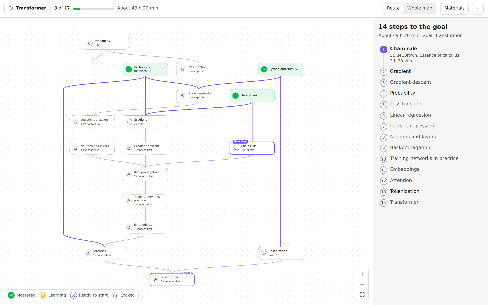
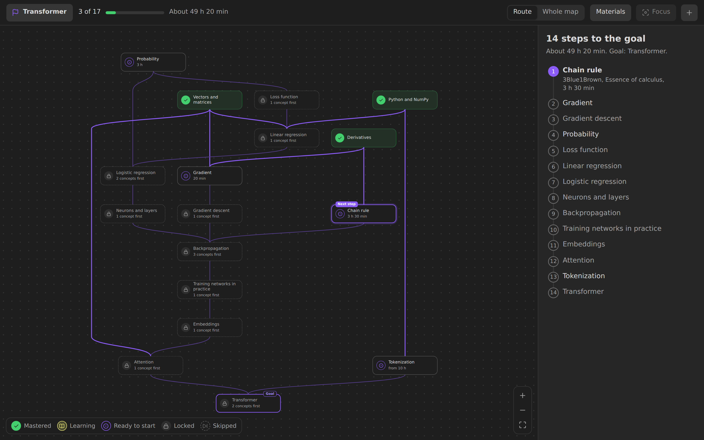
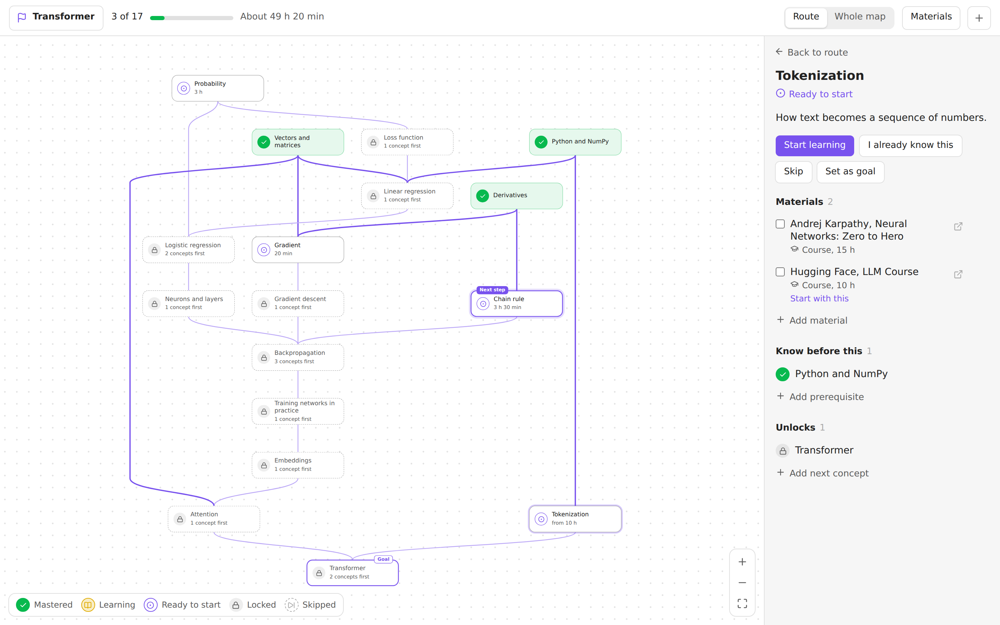
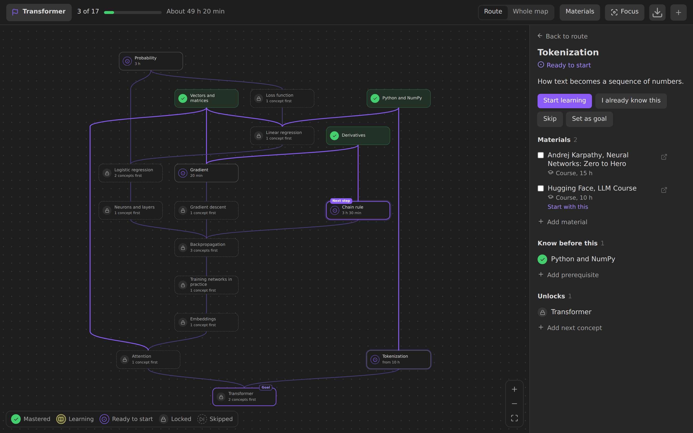
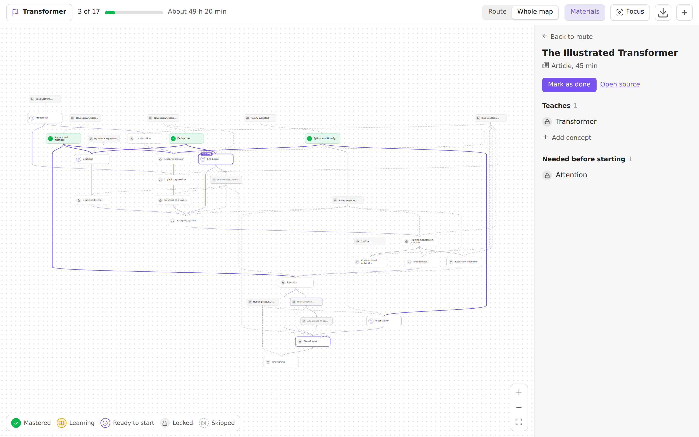
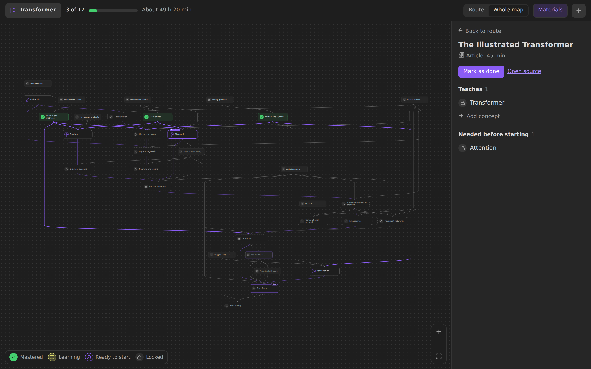

# Tropa

[Русская версия](README.ru.md)

Tropa turns ordinary notes into a graph of concepts and learning materials, and builds a personal route to any goal from what you do not know yet.



## Features

- **Route to a goal.** Pick a concept you want to learn. Tropa shows only the steps that lead to it, in order, with the next one highlighted.
- **Concepts and materials.** A concept is something you want to understand. A material is an article, video, book, paper, course or your own note that teaches it. A material can be a note of its own, or just a link or an attachment listed in the concept.
- **Progress you can see.** Mark concepts as learning or mastered and materials as done. Mastering a concept unlocks the ones that depend on it. Every action can be undone.
- **Start from what you know.** **I know this and what it needs** marks a concept together with its unmastered prerequisites in one step; untick anything you are unsure of. **Skip** leaves a concept out: it opens what depends on it but never counts as mastered. An optional confidence from 1 to 5 can be set on mastered and learning concepts.
- **Time estimate.** Material durations add up to the time left on the route.
- **Edit on the map.** Drag from the dot under a concept to another concept to link them, or to empty space to create the next one. Links that would create a cycle are refused.
- **Plain files.** The graph lives in note properties, so it syncs and travels like any other notes. Your goal and marks live in a separate file, so you can share a map without your progress.
- **Sidebar panel.** Shows where the open note sits in the graph, and adds any note to the map in one click.
- **Keyboard.** Arrow keys move between concepts, Enter opens details, Shift+Enter opens the note, M toggles mastered, Esc returns to the route.
- **33 languages.** The interface follows Obsidian's language, right-to-left included. See [Languages](#languages).

## Screenshots

| | Light | Dark |
|---|---|---|
| Route |  |  |
| Concept details |  |  |
| Whole map with materials |  |  |

## Installation

Tropa requires Obsidian 1.13.0 or later.

### From Community plugins

Once Tropa is listed: open **Settings → Community plugins → Browse**, search for **Tropa**, install it and enable it.

### Manually

1. Download `main.js`, `manifest.json` and `styles.css` from the [latest release](https://github.com/Darkildo/tropa/releases/latest).
2. Put them in `<your vault>/.obsidian/plugins/tropa/`.
3. Reload Obsidian and enable **Tropa** in **Settings → Community plugins**.

### With BRAT

Install [BRAT](https://github.com/TfTHacker/obsidian42-brat), run **BRAT: Add a beta plugin for testing** and enter `Darkildo/tropa`.

## Usage

1. Open the map with the route icon in the left ribbon or the command **Tropa: Learning map**.
2. In an empty vault, choose **Show example** to add an example map, or **Create first concept**.
3. Choose a goal in the top left corner. The panel on the right lists the steps and what to study first.
4. Click a concept, press **Start learning**, then **Mark as mastered** when you are done.
5. Switch between **Route** and **Whole map**, and turn on **Materials** to see them on the map.

Other commands: open the sidebar panel, create a concept, find a concept on the map, make the open note a concept, a material or the goal, mark it mastered, skip it, and mark it known with everything it needs.

## Data model

```yaml
# Concept
---
type: concept
requires: ["[[Derivatives]]"]     # must be mastered first
recommends: ["[[Probability]]"]   # useful, does not block access
summary: Short description
materials:                        # optional: materials without a note of their own
  - https://en.wikipedia.org/wiki/Gradient
  - "[[Deep Learning.pdf]]"
  - "[The Illustrated Transformer](https://jalammar.github.io/illustrated-transformer/)"
  - { url: https://youtu.be/IHZwWFHWa-w, title: "Gradient descent, 3Blue1Brown", format: video, minutes: 21 }
---

# Material
---
type: source
format: video                     # video, article, book, paper, course, note, other
minutes: 45
url: https://example.com
teaches: ["[[Gradient descent]]"]
requires: ["[[Derivatives]]"]     # a concept or another material
---
```

Your goal and marks are stored in `Tropa/Progress.md`:

```yaml
---
type: learning-progress
goal: "[[Transformer]]"
mastered: ["[[Derivatives]]", "[[Vectors and matrices]]"]
learning: ["[[Gradient]]"]
done: ["[[3Blue1Brown, Essence of calculus]]"]   # finished materials
skipped: ["[[Probability]]"]                      # opens what depends on it, not counted as mastered
confidence-4: ["[[Derivatives]]"]                 # optional, confidence-1 … confidence-5
done-materials:                                   # finished materials listed inside concepts
  - https://en.wikipedia.org/wiki/Gradient
  - "[[Deep Learning.pdf]]"
---
```

A material in a concept's `materials` list is a URL, a link to an attachment or a note, a Markdown link `[title](url)`, or an object with `url` or `file` and optional `title`, `format` and `minutes`. Without a title a link is named by its address and an attachment by its file name; without a format it is guessed from the address or the file extension. The same link in several concepts is one material that teaches all of them. A link that is already a material note, by the note itself or by its `url`, is shown as that note. Such materials count in the route time like any other, and the map shows them with the other materials. Finished ones go to `done-materials`: URLs as they are, attachments as links, so renaming the file keeps the mark.

`skipped`, `done-materials` and the `confidence-N` lists are written only when they hold something and removed when they become empty, so a file from an earlier version reads as it is and stays unchanged until you use them. Marks are links, so renaming a note keeps them. A link to a note that does not exist yet becomes a placeholder concept, and you can create the note with one button. Property names, folders and the progress file can be changed in the settings. Default paths follow Obsidian's language on first launch and are saved, so they do not move later.

## Demo vault (optional)

Each release has ready-made vaults with the example map and the plugin already installed: [`tropa-demo-vault.zip`](https://github.com/Darkildo/tropa/releases/latest/download/tropa-demo-vault.zip) (English) and [`tropa-demo-vault-ru.zip`](https://github.com/Darkildo/tropa/releases/latest/download/tropa-demo-vault-ru.zip) (Russian). Unzip one, choose **Open folder as vault** in Obsidian, then **Trust author and enable plugins**. You do not need them to use Tropa.

## Languages

Tropa uses the language set in Obsidian: the exact code, then the base language (`pt-PT` → `pt`), then English. Anything missing in a translation falls back to English.

Arabic (`ar`), Bengali (`bn`), Catalan (`ca`), Chinese Simplified (`zh`), Chinese Traditional (`zh-TW`), Czech (`cs`), Danish (`da`), Dutch (`nl`), English (`en`), Finnish (`fi`), French (`fr`), German (`de`), Greek (`el`), Hebrew (`he`), Hungarian (`hu`), Indonesian (`id`), Italian (`it`), Japanese (`ja`), Korean (`ko`), Norwegian (`no`), Persian (`fa`), Polish (`pl`), Portuguese (`pt`), Portuguese, Brazil (`pt-BR`), Romanian (`ro`), Russian (`ru`), Slovak (`sk`), Spanish (`es`), Swedish (`sv`), Thai (`th`), Turkish (`tr`), Ukrainian (`uk`), Vietnamese (`vi`).

These are the languages that have a finished Obsidian app translation and a website or help translation in [obsidian-translations](https://github.com/obsidianmd/obsidian-translations#existing-languages). The example map and default folder names are in English for every language except Russian.

### Fix or add a translation

- English, the source of every key, is `src/i18n/en.ts`. Other languages are `src/i18n/locales/<code>.json`, where the code is what Obsidian's `getLanguage()` returns.
- Keep placeholders such as `{title}` or `{count}` as they are.
- Plural messages are objects with [CLDR plural forms](https://www.unicode.org/cldr/charts/latest/supplemental/language_plural_rules.html) of the language: `one`, `few`, `many`, `other` and so on. A form may spell the number out, as in “two steps”, but `other` must keep `{count}`.
- A new language also needs a line in `src/i18n/locales/index.ts`.
- `npm test` checks every file: same keys as English, the same placeholders, every plural form the language needs. `npm run e2e` opens the interface in several languages, right-to-left included.

## Development

```bash
npm install
npm run lint         # ESLint with the Obsidian plugin rules
npm test             # core: graph, states, cycles, route, layout, example map, i18n
npm run build        # main.js
npm run dev          # rebuild on change
npm run demo         # demo vaults in dist/Tropa Demo and dist/Tropa Demo RU
npm run preview      # browser build on a mocked API in dist/preview
npm run e2e          # UI checks in Chromium (Playwright)
npm run screenshots  # README images in docs/screenshots
```

`npm run e2e` and `npm run screenshots` need a Chromium for Playwright: `npx playwright install chromium`, or set `CHROMIUM_PATH` to an installed one.

- `src/core`: logic with no dependency on Obsidian.
- `src/i18n`: strings. English in `en.ts`, other languages in `locales/`.
- `src/store.ts`: reads the vault, keeps progress, writes links.
- `src/ui`: map, sidebar panel, modals.
- `harness`: a mock of the Obsidian API that runs the real plugin code in a browser.

To release, add a section for the new version to [`CHANGELOG.md`](CHANGELOG.md), run `npm version patch` (or `minor`, `major`) and push the tag: `git push --follow-tags`. The workflow builds the plugin and publishes a release with `main.js`, `manifest.json`, `styles.css` and the demo vaults; the changelog section becomes the release notes, and the build fails if it is missing.

## Limitations

- Node positions are computed automatically and cannot be dragged.
- A material listed in a concept cannot require anything. When a material needs its own prerequisites, make it a note.
- Layout blocks the interface when the shape of the graph changes: about 0.4 s for 100 concepts, 1 s for 200 and 3.5 s for 400 with dense links.

## License

[MIT](LICENSE)
