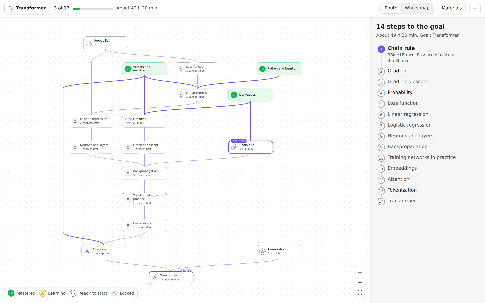
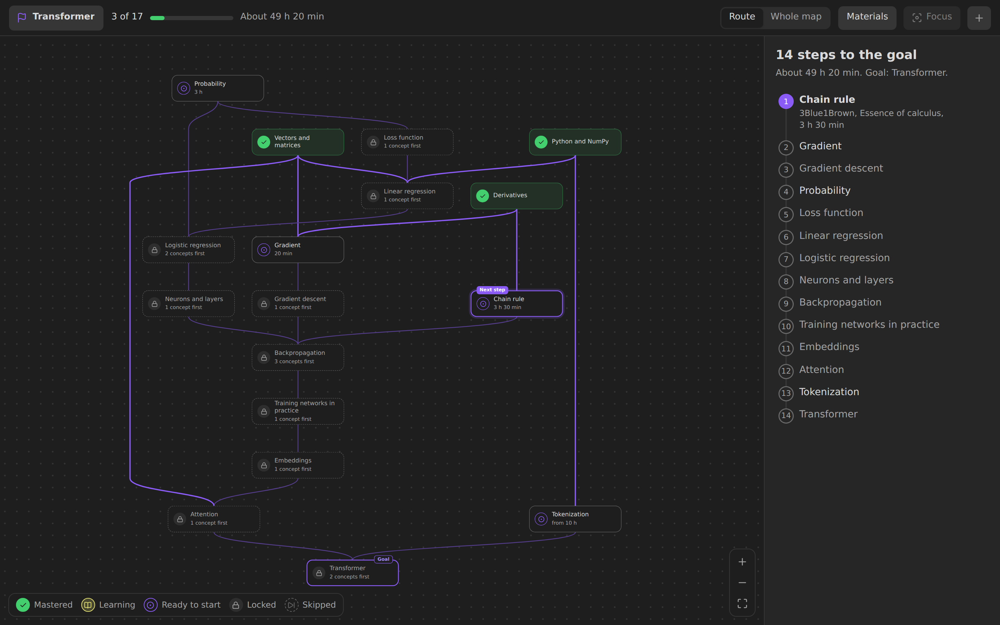
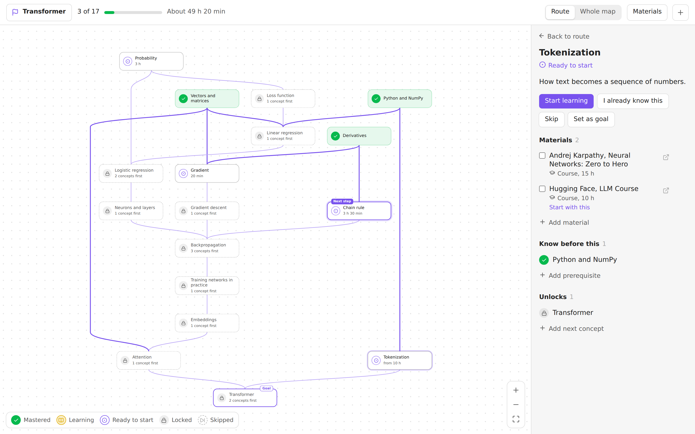
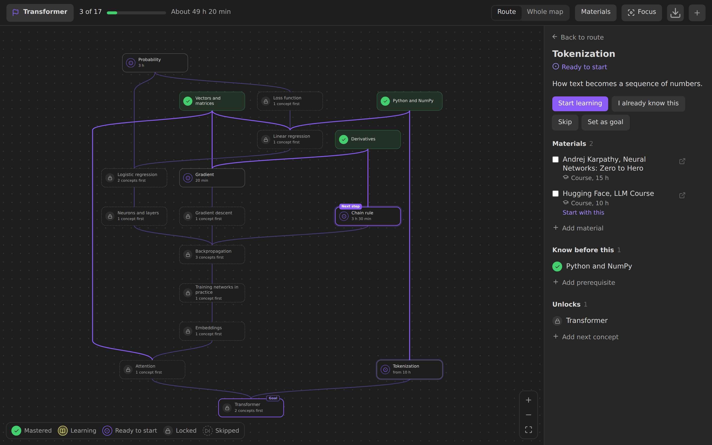
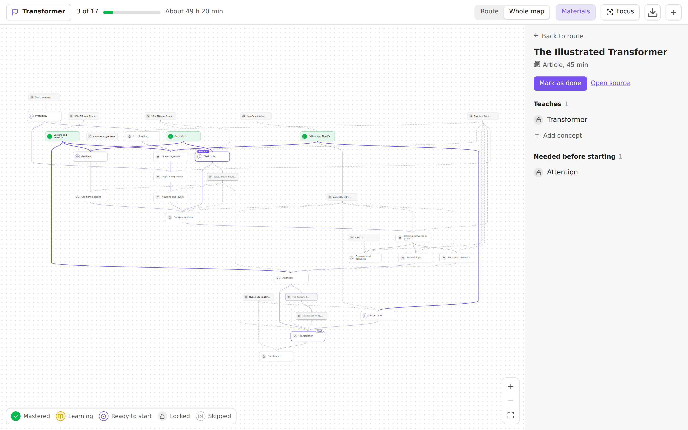
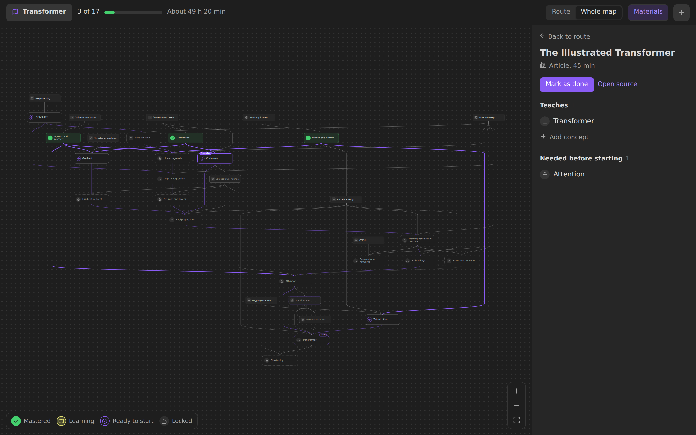
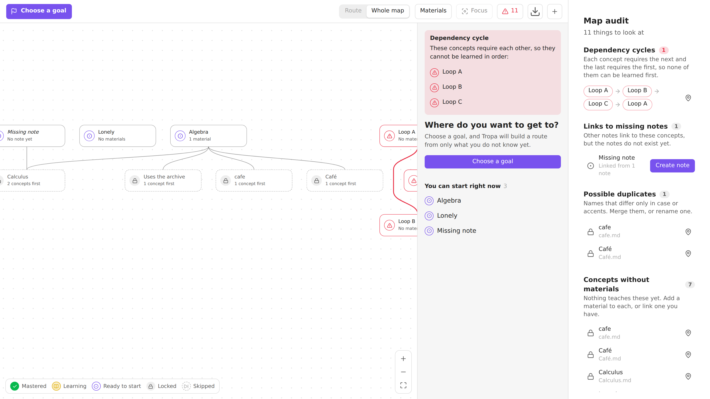

# Tropa

[English version](README.md)

Плагин для Obsidian: граф концептов и материалов из обычных заметок и личный маршрут к любой цели из того, чего вы ещё не знаете.



## Что нового в 0.3

- **Пропуск, уверенность и «я это знаю»** для карт, часть которых вы уже знаете.
- **Материалы без заметки:** ссылки и вложения прямо в концепте.
- **Область карты:** папки и теги, которые не попадают на карту.
- **Фокус и свёртка,** чтобы видеть только то, что рядом с концептом.
- **Проверка карты** со счётчиком в шапке.
- **Экспорт** в Canvas и SVG.
- **Собственный движок раскладки,** работающий как WebAssembly в фоновом потоке: большие карты раскладываются за доли секунды и с меньшим числом пересечений.

Нужен Obsidian 1.13.0. Полный список — в [журнале изменений](CHANGELOG.md) (на английском).

## Возможности

- **Маршрут к цели.** Выберите концепт, который хотите освоить. Tropa покажет только шаги, ведущие к нему, по порядку, и выделит следующий.
- **Концепты и материалы.** Концепт — то, что вы хотите понять. Материал — статья, видео, книга, научная статья, курс или своя заметка, по которой вы его изучаете. Материал может быть отдельной заметкой или просто ссылкой или вложением в списке концепта.
- **Видимый прогресс.** Отмечайте концепты как изучаемые или освоенные, а материалы как пройденные. Освоенный концепт открывает зависящие от него. Любое действие можно отменить.
- **Старт с того, что уже знаете.** **Знаю это и всё, что нужно до него** отмечает концепт вместе с неосвоенными пререквизитами за один шаг; с сомнительных можно снять галочку. **Пропустить** убирает концепт с пути: он открывает зависящие от него, но не считается освоенным. У освоенных и изучаемых концептов можно поставить уверенность от 1 до 5.
- **Оценка времени.** Длительности материалов складываются в оставшееся время маршрута.
- **Несколько целей, срок и темп.** Целей может быть несколько: кнопка цели переключает их или строит маршрут сразу ко всем, и шаг, который нужен не всем целям, называет свои. В **Срок и темп…** задаются часы занятий в неделю и срок для каждой цели, и маршрут показывает, когда вы закончите при таком темпе, что требует каждый срок и сколько шагов ещё без оценки времени.
- **Фокус и свёртка.** **Фокус** (или F) оставляет на карте только то, что рядом с выбранным концептом: что ему нужно, что он открывает, и мягкие связи, на один–три шага вокруг, вместе с материалами, если включены **Материалы**. Esc или крестик возвращают карту такой, какой она была. Значок под концептом сворачивает всё, что от него зависит, и показывает, сколько концептов скрыто; подсвеченный значок значит, что среди них есть шаги маршрута, они же помечены в списке маршрута. Если выбрать такой шаг, его ветка развернётся. Фокус и свёртки относятся к виду карты: они хранятся в раскладке рабочего пространства Obsidian, а не в заметках и не в прогрессе.
- **Экспорт.** Кнопка загрузки в шапке или команды **Экспортировать карту в Canvas** и **Экспортировать карту в SVG** сохраняют карту такой, какой она нарисована сейчас: маршрут или вся карта, с материалами, фокусом и свёртками. Canvas сохраняет расположение и ссылается на ваши заметки, поэтому открывается в Obsidian Canvas; раскраска по вашему прогрессу необязательна, так что картой можно поделиться без него. В JSON Canvas нет пунктирных линий, поэтому мягкие связи оранжевые с подписью, а связи материалов голубые. SVG берёт цвета и шрифты текущей темы. Существующий файл никогда не заменяется без вопроса.
- **Правка на карте.** Потяните от точки под концептом к другому концепту, чтобы связать их, или на пустое место, чтобы создать следующий. Связь, которая замкнёт цикл, не добавится.
- **Обычные файлы.** Граф лежит в свойствах заметок, поэтому синхронизируется и передаётся как любые заметки. Цель и отметки хранятся отдельно, и карту можно передать без вашего прогресса.
- **Боковая панель.** Показывает место открытой заметки в графе и добавляет любую заметку на карту одним нажатием.
- **Журнал обучения.** Каждое изменение прогресса дописывается строкой в файл журнала, по файлу на месяц и устройство, поэтому устройства никогда не правят один файл. Боковая панель подводит итог: сколько концептов освоено, сколько времени ушло на пройденные материалы и сколько было повторений за 7 и 30 дней, со всех устройств. Подробнее в разделе [Журнал обучения](#журнал-обучения).
- **Проверка карты.** Команда **Tropa: Проверить карту** собирает в один список всё, что требует внимания:
  - циклы в зависимостях, цепочкой до исходного концепта;
  - ссылки на несуществующие заметки, со счётчиком ссылок и кнопкой «Создать заметку»;
  - возможные дубли, то есть названия, которые отличаются только регистром или диакритикой;
  - концепты без материалов;
  - заметки без единой связи.

  Каждая строка открывает заметку или показывает её на карте, а список обновляется по мере исправлений. Когда есть что проверить, кнопка в шапке карты показывает, сколько находок (красным, если есть цикл), и открывает проверку.
- **Клавиатура.** Стрелки переходят между концептами, Enter открывает подробности, Shift+Enter открывает заметку, M ставит или снимает отметку об освоении, F включает и выключает фокус на концепте, 1–3 задают число шагов вокруг, C сворачивает или разворачивает то, что концепт открывает, Esc выходит из фокуса, а затем возвращает к маршруту.
- **33 языка.** Язык интерфейса берётся из настроек Obsidian, письмо справа налево тоже поддерживается. Список в разделе [Языки](#языки).

## Скриншоты

| | Светлая тема | Тёмная тема |
|---|---|---|
| Маршрут |  |  |
| Подробности концепта |  |  |
| Вся карта с материалами |  |  |

Проверка карты, открытая кнопкой в шапке: цикл, ссылка на несуществующую заметку, дубль названия, концепты без материалов и заметка без связей.



Скриншоты сняты с английским интерфейсом и английским примером. С русским языком Obsidian всё выглядит так же, но по-русски.

## Установка

Нужен Obsidian 1.13.0 или новее.

### Из каталога плагинов

Когда Tropa появится в каталоге: **Настройки → Сторонние плагины → Обзор**, найдите **Tropa**, установите и включите.

### Вручную

1. Скачайте `main.js`, `manifest.json` и `styles.css` из [последнего релиза](https://github.com/Darkildo/tropa/releases/latest).
2. Положите их в `<хранилище>/.obsidian/plugins/tropa/`.
3. Перезапустите Obsidian и включите **Tropa** в **Настройки → Сторонние плагины**.

### Через BRAT

Установите [BRAT](https://github.com/TfTHacker/obsidian42-brat), выполните **BRAT: Add a beta plugin for testing** и укажите `Darkildo/tropa`.

## Как пользоваться

1. Откройте карту значком маршрута на левой панели или командой **Tropa: Карта обучения**.
2. В пустом хранилище нажмите **Показать пример** или **Создать первый концепт**.
3. Выберите цель в левом верхнем углу. Панель справа покажет шаги и с чего начать. Та же кнопка потом добавляет цели, переключает их, показывает маршрут ко всем сразу и открывает **Срок и темп…**.
4. Нажмите концепт, затем **Начать изучение**, а когда разберётесь — **Отметить освоенным**.
5. Переключайте **Маршрут** и **Вся карта**, кнопка **Материалы** показывает материалы на карте.
6. На большой карте выберите концепт и нажмите **Фокус**, чтобы видеть только то, что рядом, или сверните лишние ветки значком под концептом.

### На телефоне

- Шапка в одну строку: цель, **Маршрут** и **Вся карта** значками и **⋯**, где материалы, фокус, проверка карты (число находок видно на кнопке), экспорт и новый концепт. Прогресс — тонкая полоса под шапкой.
- Одним пальцем карта двигается, двумя — масштабируется, двойное касание приближает. Свайпы внутри карты и панели двигают карту или панель и не открывают боковые панели Obsidian; для них свайпайте по шапке или используйте кнопки Obsidian.
- Касание концепта открывает подробности. Долгое нажатие открывает его меню, где есть и связь со следующим концептом (точки для перетаскивания на телефоне нет).
- Панель стоит над навигационной панелью Obsidian. Касание или перетаскивание ручки переключает её между заголовком, половиной экрана и почти всем экраном.
- Карта открывается и вписывается в читаемом масштабе, с центром на выбранном концепте, следующем шаге или цели.

Другие команды: проверить карту, открыть боковую панель, создать концепт, найти концепт на карте, экспортировать карту в Canvas или SVG, сделать открытую заметку концептом или материалом, добавить её в цели или убрать из них, задать срок и темп, отметить её освоенной, пропустить её, отметить известной вместе со всем, что для неё нужно.

## Модель данных

```yaml
# Концепт
---
type: concept
requires: ["[[Производная]]"]    # обязательно до этого
recommends: ["[[Вероятность]]"]  # желательно, не закрывает доступ
summary: Короткое описание
materials:                       # необязательно: материалы без отдельной заметки
  - https://ru.wikipedia.org/wiki/Градиент
  - "[[Deep Learning.pdf]]"
  - "[The Illustrated Transformer](https://jalammar.github.io/illustrated-transformer/)"
  - { url: https://youtu.be/IHZwWFHWa-w, title: "Градиентный спуск, 3Blue1Brown", format: video, minutes: 21 }
---

# Материал
---
type: source
format: video                    # video, article, book, paper, course, note, other
minutes: 45
url: https://example.com
teaches: ["[[Градиентный спуск]]"]
requires: ["[[Производная]]"]    # концепт или другой материал
---
```

Цель и отметки лежат в `Tropa/Прогресс.md` (при английском языке Obsidian — в `Tropa/Progress.md`):

```yaml
---
type: learning-progress
goal: "[[Трансформер]]"                            # цель, к которой ведёт маршрут
goals: ["[[Трансформер]]", "[[Дообучение моделей]]"] # необязательно: все цели, когда их больше одной
all-goals: true                                    # необязательно: маршрут сразу ко всем целям
deadline-2026-12-31: ["[[Трансформер]]"]           # необязательно: цели со сроком в этот день
pace-hours: 5                                      # необязательно: часов занятий в неделю
mastered: ["[[Производная]]", "[[Векторы и матрицы]]"]
learning: ["[[Градиент]]"]
done: ["[[3Blue1Brown, Essence of calculus]]"]   # пройденные материалы
skipped: ["[[Вероятность]]"]                      # открывает зависящие, не считается освоенным
confidence-4: ["[[Производная]]"]                 # необязательно, confidence-1 … confidence-5
done-materials:                                   # пройденные материалы из списков концептов
  - https://ru.wikipedia.org/wiki/Градиент
  - "[[Deep Learning.pdf]]"
---
```

Материал в списке `materials` концепта — это URL, ссылка на вложение или заметку, Markdown-ссылка `[название](url)` или объект с `url` или `file` и необязательными `title`, `format` и `minutes`. Без названия ссылка называется по адресу, вложение — по имени файла; без формата он угадывается по адресу или расширению. Одна и та же ссылка в нескольких концептах — один материал, который учит всем им. Ссылка, которая уже есть как заметка-материал (сама заметка или её `url`), показывается этой заметкой. Такие материалы учитываются во времени маршрута, как любые другие, а на карте показываются вместе с остальными материалами. Пройденные попадают в `done-materials`: URL как есть, вложения ссылками, поэтому переименование файла отметку не теряет.

В `goal` всегда лежит цель, к которой ведёт маршрут, поэтому прошлая версия Tropa читает такой файл как раньше и строит маршрут к этой цели; цель, которую она туда запишет, добавится в `goals`. Сроки сгруппированы по датам и записаны обычными ссылками, поэтому переименование заметки их не теряет, а редактор свойств показывает их обычным списком. Прогноз считает длительности материалов на маршруте от сегодняшнего дня, и день срока тоже считается днём занятий.

Свойства `goals`, `all-goals`, списки `deadline-…`, `pace-hours`, а также списки `skipped`, `done-materials` и `confidence-N` пишутся, только когда в них что-то есть, и удаляются, когда пустеют. Файл от прошлой версии читается как есть и не меняется, пока вы ими не воспользуетесь. Отметки — это ссылки, поэтому переименование заметки их не теряет. Ссылка на несуществующую заметку становится концептом-заготовкой, заметку для него можно создать одной кнопкой. Названия свойств, папки и файл прогресса меняются в настройках. Пути по умолчанию выбираются по языку Obsidian при первом запуске и сохраняются, поэтому потом не переезжают.

### Область карты

**Настройки → Tropa → Область карты** убирает заметки с карты, по одной записи в строке:

- **Исключённые папки**: папка и всё, что в ней. Папки сравниваются по целым сегментам пути, поэтому `Архив` не задевает `Архив 2`. Не исключайте папки концептов и материалов: туда попадает то, что вы создаёте с карты, и Tropa предупредит, если они окажутся в списке.
- **Исключённые теги**: теги из свойства `tags` и из текста заметки, `#` необязателен, регистр не важен. Тег исключает и вложенные: `#черновик` убирает и `#черновик/старое`.

Исключённые заметки убираются с карты полностью: ссылка `requires`, `recommends` или `teaches` на такую заметку отбрасывается, поэтому она не добавляет ни узла, ни шага маршрута и ничего не блокирует, а то, что ждало только её, становится доступным. Боковая панель по-прежнему говорит, что открытая заметка вне карты. Отметки на исключённых заметках остаются в файле прогресса как есть и вернутся вместе с заметкой, а сам файл прогресса читается, даже если его папка исключена. Вложения из списка `materials` концепта остаются на карте, где бы они ни лежали: область выбирает заметки, а не файлы, на которые ссылается заметка с карты. Если исключена сама цель, Tropa об этом скажет и предложит выбрать другую цель или поменять настройки.

### Журнал обучения

`Tropa/Прогресс.md` говорит, где вы сейчас, а журнал — как вы к этому пришли. Каждое изменение на этом устройстве дописывается в `Tropa/Журнал/<ГГГГ-ММ> <устройство>.md`:

```markdown
- 2026-11-03T14:05:12+03:00 started [[Градиент]]
- 2026-11-03T14:31:40+03:00 mastered [[Градиент]]
- 2026-11-03T14:31:44+03:00 unmastered [[Градиент]] undo
- 2026-11-03T14:40:02+03:00 confidence [[Производная]] level=4
- 2026-11-03T15:10:00+03:00 done https://ru.wikipedia.org/wiki/Градиент
```

- Строка — это местное время со смещением, действие, заметка ссылкой (для материала из списка концепта — URL или `[[вложение]]`, `-` — ничего) и необязательные поля `ключ=значение` и флаги. Действия пишутся по-английски при любом языке интерфейса: `goal` (цель, к которой теперь ведёт маршрут), `goal-added` и `goal-removed` (другие цели добавлены или убраны), `deadline` (`date=` или `date=none`), `pace` (`hours=` или `hours=none`), `started`, `stopped`, `mastered`, `known` (отмечено через **Знаю это**), `unmastered`, `skipped`, `unskipped`, `done`, `undone`, `confidence`; `reviewed` и `checked` зарезервированы для повторений и самопроверки.
- Отмена дописывает строки с флагом `undo`, которые возвращают всё назад, а не стирает строки: файлы только растут, и синхронизации никогда не нужно сводить две версии одного файла.
- Имя устройства, например `desktop-3f9a` или `phone-07c1`, Obsidian хранит на самом устройстве и не синхронизирует. Каждое устройство пишет только свой файл и читает все, поэтому активность в панели охватывает все устройства.
- Ссылки следуют за переименованиями, как любые ссылки. Строки, которые не разбираются, например ваши заметки между ними, пропускаются.
- Пишутся только изменения, сделанные в Tropa. Файл прогресса, поправленный вручную или пришедший синхронизацией с другого устройства, в журнал не попадает: то устройство пишет свои строки само.
- **Настройки → Tropa → Журнал обучения** выключает журнал или меняет папку. Папка журнала никогда не попадает на карту. Хранилища без журнала работают как раньше; активность появляется в панели, когда есть что показать.

## Демо-хранилище (необязательно)

К каждому релизу приложены готовые хранилища с примером карты и установленным плагином: [`tropa-demo-vault-ru.zip`](https://github.com/Darkildo/tropa/releases/latest/download/tropa-demo-vault-ru.zip) (русский) и [`tropa-demo-vault.zip`](https://github.com/Darkildo/tropa/releases/latest/download/tropa-demo-vault.zip) (английский). Распакуйте, в Obsidian выберите **Open folder as vault**, затем **Trust author and enable plugins**. Для работы плагина они не нужны.

## Языки

Tropa берёт язык из настроек Obsidian: сначала точный код, затем базовый язык (`pt-PT` → `pt`), затем английский. Если в переводе чего-то нет, показывается английский текст.

Английский (`en`), арабский (`ar`), бенгальский (`bn`), венгерский (`hu`), вьетнамский (`vi`), голландский (`nl`), греческий (`el`), датский (`da`), иврит (`he`), индонезийский (`id`), испанский (`es`), итальянский (`it`), каталанский (`ca`), китайский упрощённый (`zh`), китайский традиционный (`zh-TW`), корейский (`ko`), немецкий (`de`), норвежский (`no`), персидский (`fa`), польский (`pl`), португальский (`pt`), португальский бразильский (`pt-BR`), румынский (`ro`), русский (`ru`), словацкий (`sk`), тайский (`th`), турецкий (`tr`), украинский (`uk`), финский (`fi`), французский (`fr`), чешский (`cs`), шведский (`sv`), японский (`ja`).

Это языки, у которых в [obsidian-translations](https://github.com/obsidianmd/obsidian-translations#existing-languages) готов перевод приложения и есть перевод сайта или справки. Пример карты и названия папок по умолчанию на всех языках, кроме русского, английские.

### Как поправить или добавить перевод

- Английский — источник всех ключей — лежит в `src/i18n/en.ts`. Остальные языки — в `src/i18n/locales/<код>.json`, где код совпадает с тем, что возвращает `getLanguage()` в Obsidian.
- Плейсхолдеры вроде `{title}` и `{count}` оставляйте как есть.
- Сообщения с числами — объекты с [формами множественного числа CLDR](https://www.unicode.org/cldr/charts/latest/supplemental/language_plural_rules.html) для языка: `one`, `few`, `many`, `other` и т. д. Форма может назвать число словами («два шага»), но в `other` должен остаться `{count}`.
- Новый язык нужно ещё добавить строкой в `src/i18n/locales/index.ts`.
- `npm test` проверяет каждый файл: те же ключи, что в английском, те же плейсхолдеры, все нужные языку формы множественного числа. `npm run e2e` открывает интерфейс на нескольких языках, в том числе справа налево.

## Разработка

```bash
npm install
npm run build:wasm   # WebAssembly движка раскладки, нужен для build, e2e и бенчмарка (см. «Сборка»)
npm run lint         # ESLint с правилами для плагинов Obsidian
npm test             # ядро: граф, состояния, циклы, маршрут, раскладка, пример карты, i18n
npm run build        # main.js
npm run dev          # пересборка при изменениях
npm run demo         # демо-хранилища в dist/Tropa Demo и dist/Tropa Demo RU
npm run preview      # браузерная сборка на заглушке API в dist/preview
npm run e2e          # проверка интерфейса в Chromium (Playwright)
npm run screenshots  # картинки для README в docs/screenshots
npm run bench        # время раскладки и качество рисунка против раскладки 0.1 (dagre)
npm run bench:chromium  # то же в Chromium и сколько при этом стоит интерфейс
npm run locales:check   # переводы в main.js в точности совпадают с src/i18n/locales (после build)
```

Для `npm run e2e` и `npm run screenshots` нужен Chromium для Playwright: `npx playwright install chromium` или путь к установленному в `CHROMIUM_PATH`.

- `src/core`: логика без зависимости от Obsidian. Раскладка карты — `sugiyama.ts` за интерфейсом движка в `layout-engine.ts`; `layout-runner.ts` считает её в фоновом потоке для больших карт.
- `crates/tropa-layout`: тот же движок раскладки на Rust, скомпилированный в WebAssembly. Им раскладываются большие карты, в фоновом потоке.
- `src/i18n`: строки. Английский в `en.ts`, остальные языки в `locales/`.
- `src/store.ts`: чтение хранилища, прогресс, запись связей.
- `src/ui`: карта, боковая панель, модальные окна.
- `harness`: заглушка Obsidian API, чтобы запускать настоящий код плагина в браузере.

Релиз: добавить раздел новой версии в [`CHANGELOG.md`](CHANGELOG.md), затем `npm version patch` (или `minor`, `major`) и `git push --follow-tags`. Workflow соберёт плагин и опубликует релиз с `main.js`, `manifest.json`, `styles.css` и демо-хранилищами. Текст релиза берётся из раздела CHANGELOG, без него сборка падает.

## Сборка

В `main.js` движок раскладки лежит дважды: на TypeScript (`src/core/sugiyama.ts`) и в виде WebAssembly, скомпилированного из его порта на Rust (`crates/tropa-layout`). С ним вся раскладка в 2–3 раза быстрее, и в фоновом потоке работает он. Где нет WebAssembly или фоновых потоков, работает TypeScript. Оба рисуют одну и ту же карту до последнего бита: `npm test` сравнивает их на всех графах бенчмарка.

WebAssembly собирается из исходников и в git не хранится:

1. Поставьте Rust через [rustup](https://rustup.rs). `crates/tropa-layout/rust-toolchain.toml` закрепляет компилятор (1.99.1) и таргет `wasm32-unknown-unknown`; rustup поставит их при первом запуске.
2. Запустите `npm run build:wasm`. Скрипт компилирует крейт (`opt-level=3`, LTO, одна единица кодогенерации, `panic=abort`), оптимизирует результат через `wasm-opt -O3` из npm-пакета `binaryen` (версия закреплена) и пишет `dist/wasm/tropa_layout.wasm` с размером и sha256.
3. `npm run build` встраивает его в `main.js` как base64.

`npm run build:wasm -- --verify` собирает модуль второй раз с нуля и падает, если сборки не совпали байт в байт. CI делает эту проверку в каждом пул-реквесте.

Переводы по пути в `main.js` упаковываются (`locales.esbuild.mjs`): только значения в порядке английских ключей, в виде JSON, сжатого raw DEFLATE и записанного в base64. Так они занимают около трети своего размера в виде обычного JSON. При запуске `src/i18n/pack.ts` распаковывает только активный язык, синхронно и быстрее миллисекунды. Файлы, которые вы правите, остаются обычным JSON в `src/i18n/locales`.

### Для ревьюеров каталога

В `main.js` есть base64-строки двух видов. Переводы (см. выше) — это текст: `npm run build && npm run locales:check` распаковывает каждый и проверяет, что он в точности совпадает с файлом в `src/i18n/locales`; CI делает это в каждом пул-реквесте.

Единственный бинарный фрагмент — base64-строка WebAssembly движка раскладки внутри скрипта фонового потока. У модуля нет импортов: ни сети, ни файловой системы, ни доступа к странице. Он получает размеры узлов и связи, а возвращает координаты и пути рёбер. Workflow релиза собирает его из `crates/tropa-layout` (без зависимостей), печатает sha256 в лог и добавляет его в описание релиза.

Как проверить релиз:
1. Возьмите его тег и выполните `npm ci && npm run build:wasm`.
2. Сравните напечатанный sha256 с указанным в описании релиза.
3. При желании раскодируйте base64-строку из `main.js` (`tropa:layout-wasm`) и сравните и её.

## Ограничения

- Расположение узлов считается автоматически, перетаскивать их нельзя.
- Материал из списка концепта не может ничего требовать. Если у материала есть свои пререквизиты, сделайте его заметкой.
- Большие карты раскладываются не сразу, но интерфейс при этом не замирает: в Chromium на компьютере около 25 мс на 400 концептов, 0,2 с на 400 концептов с материалами и 0,9 с на 1000 с материалами (плотные синтетические карты, `npm run bench:chromium`). Без WebAssembly в 2–3 раза дольше, на телефоне ещё в несколько раз дольше.

## Лицензия

[MIT](LICENSE)
